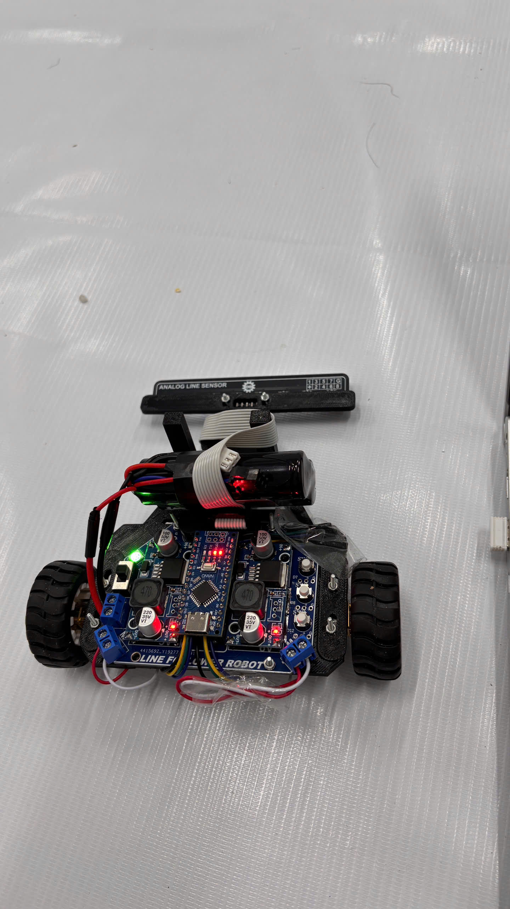
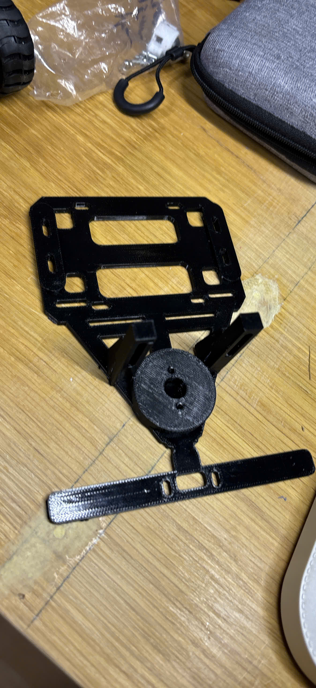

# 3D-Printed Line-Follower Chassis




Custom one-piece chassis for a line-following and maze-solving robot. The frame was modeled in OpenSCAD, fabricated by 3D printing, and evaluated with the real electronics and sensor layout shown below.

## 30-second overview

| Question | Answer |
|---|---|
| What did I design? | A parametric, one-piece F-Maze V5.2 chassis for a line-following and maze-solving robot. |
| What problem does it solve? | It packages the controller, motors, line sensor, caster, battery, wiring, and HC-SR04 mounts into one printable frame. |
| What does this repo prove? | Parametric CAD, design-for-additive-manufacturing, mechanical integration, and physical prototyping. |
| Best evidence | Editable OpenSCAD, printable STL, real printed chassis, assembled robot, and two public videos. |

## My contribution

- Designed the chassis geometry and mounting layout in OpenSCAD.
- Created adjustable slots and clearances for uncertain real-world dimensions.
- Corrected the caster recess so the main plate no longer filled the intended pocket.
- Produced the STL, printed prototype, assembled hardware, and documented the design.

<details>
<summary><strong>Tóm tắt tiếng Việt</strong></summary>

Khung xe dò line F-Maze V5.2 được thiết kế tham số bằng OpenSCAD và in thành một khối. Thiết kế tích hợp gá mạch, động cơ, cảm biến line, bi đỡ, dây buộc và vị trí HC-SR04; các kích thước chưa đo được được xử lý bằng khe điều chỉnh và cảnh báo kiểm chứng.

</details>

## Design goals

- One-piece printable frame with a rigid Y-shaped front section.
- Mounting area for the line-sensor array and controller board.
- Adjustable slots for the two motor brackets.
- Recess and mounting holes for a 3PI-style ball caster.
- Uprights for an HC-SR04 ultrasonic sensor.
- Cable-tie and hook-and-loop strap openings.

## Engineering decisions

- **One-piece frame:** reduces assembly hardware and alignment errors.
- **Y-shaped front truss:** connects the sensor bar to the main frame while limiting material use.
- **Slotted mounts:** preserve adjustability where component dimensions are not fully verified.
- **Parametric OpenSCAD source:** makes mounting positions and frame dimensions reviewable and editable.

## Prototype

| Printed chassis | Assembled robot |
|---|---|
|  |  |

## Demonstration videos

- [Line-following demonstration 1](media/videos/line-following-demo-1.mp4)
- [Line-following demonstration 2](media/videos/line-following-demo-2.mp4)

## CAD files

The `cad/F_Maze_V5_2_HCSR04/` directory contains:

- `F_Maze_V5_2_CAD_KiemTra_HCSR04.scad` — editable OpenSCAD model.
- `F_Maze_V5_2_KHUNG_THU_LAP_CHUA_IN.stl` — STL exported for slicer preview.
- `THAY_DOI_V5_2.txt` — revision notes and validation status.
- `THONG_SO_HC_SR04.txt` — HC-SR04 reference dimensions.

Open the `.scad` file in OpenSCAD. Select `assembly`, `frame`, `top2d`, or `side2d` with the `MODE` parameter, then press **F5** to preview.

## Known dimensions

| Item | Value |
|---|---:|
| Controller-board front hole spacing | 40 mm |
| Controller-board rear hole spacing | 48 mm |
| Controller-board row spacing | 55 mm |
| Line-sensor mounting-hole spacing | 20 mm |
| Motor-bracket hole spacing | 17 mm |
| 3PI caster mounting-hole spacing | 15 mm |
| HC-SR04 outer envelope | 43 × 20 × 17 mm |
| Nominal wheel diameter | 44 mm |

## Repository structure

```text
.
├── cad/
│   └── F_Maze_V5_2_HCSR04/
├── media/
│   ├── images/
│   └── videos/
└── README.md
```

## Status

- Physical chassis printed.
- Electronics and line sensor mounted on a prototype.
- Two demonstration videos included.

## Skills demonstrated

`OpenSCAD` · `parametric CAD` · `FDM 3D printing` · `design for assembly` · `robot mechanics` · `fit-check prototyping` · `technical risk documentation`

## License

- OpenSCAD and other source code: [MIT License](LICENSE).
- CAD and STL design files: [Creative Commons Attribution 4.0 International](LICENSE-CAD.md).
- Photos and videos remain © Huynh Tri Phat. Reuse requires permission.
